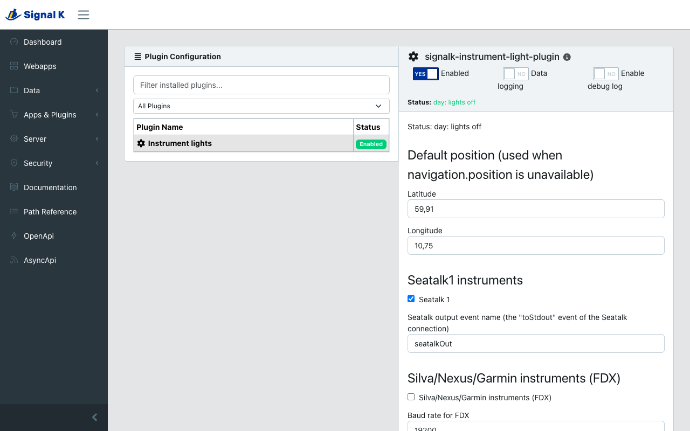
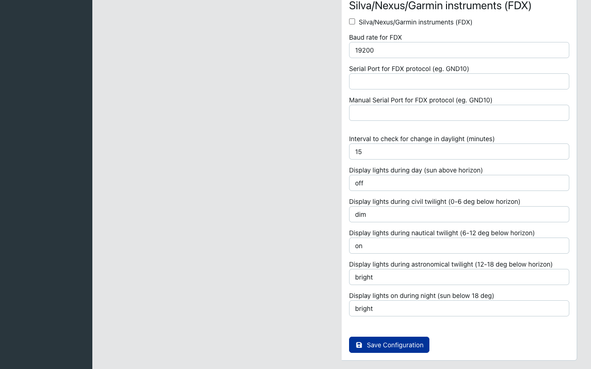

# Instrument Lights for Signal K

[](https://github.com/joabakk/signalk-instrument-light-plugin/actions/workflows/signalk-ci.yml)
[](https://www.npmjs.com/package/signalk-instrument-light-plugin)

A [Signal K](https://signalk.org) server plugin that dims and brightens your instrument backlights automatically, following the sun.

The plugin works out the sun's elevation from the boat's position, picks the phase of the day and sends the light level you chose for that phase to your instruments:

| Phase | Sun elevation |
|---|---|
| Day | above the horizon |
| Civil twilight | 0–6° below the horizon |
| Nautical twilight | 6–12° below the horizon |
| Astronomical twilight | 12–18° below the horizon |
| Night | more than 18° below the horizon |

Each phase can be set to **off**, **dim**, **on** or **bright**. The level is resent every 30 seconds so instruments that were switched on later pick it up too.



## Supported instruments

- **Raymarine Seatalk1** – sends the lamp intensity datagram (`30 00 0X`) as a `$STALK` sentence, for a Seatalk1 gateway that understands them, such as a Shipmodul MiniPlex.
- **Silva, Nexus and Garmin (FDX)** – writes the FDX backlight command to a serial port, for example a Garmin GND10 or a Nexus server connected over USB.

## Setup

1. Install **Instrument Lights** from the App Store in the Signal K admin UI.
2. Open *Server → Plugin Config → Instrument lights* and enable it.
3. Set a light level for each phase of the day.
4. Turn on the outputs you need:
   - **Seatalk1:** enter the output event name, and set the same name as an output event (`toStdout`) on the serial data connection to your Seatalk1 gateway.
   - **FDX:** pick the serial port of your FDX interface, or choose *[Enter Manually]* and type its path.
5. Optionally enter a default position. It is used when the server has no `navigation.position`, for example at the dock without GPS.



The plugin's status line in the admin UI shows the current phase and light level, for example *Civil twilight: lights dim*.

## Signal K data

The plugin publishes:

| Path | Value |
|---|---|
| `environment.mode` | `day`, `Civil twilight`, `Nautical twilight`, `Astronomical twilight` or `night` |
| `navigation.sun.elevation` | Sun elevation above the horizon (rad) |

## Development

```bash
npm install
npm test
```

The tests use Node's built-in test runner and need Node.js 20 or newer. See the [changelog](./CHANGELOG.md) for release notes.

## License

Apache-2.0
